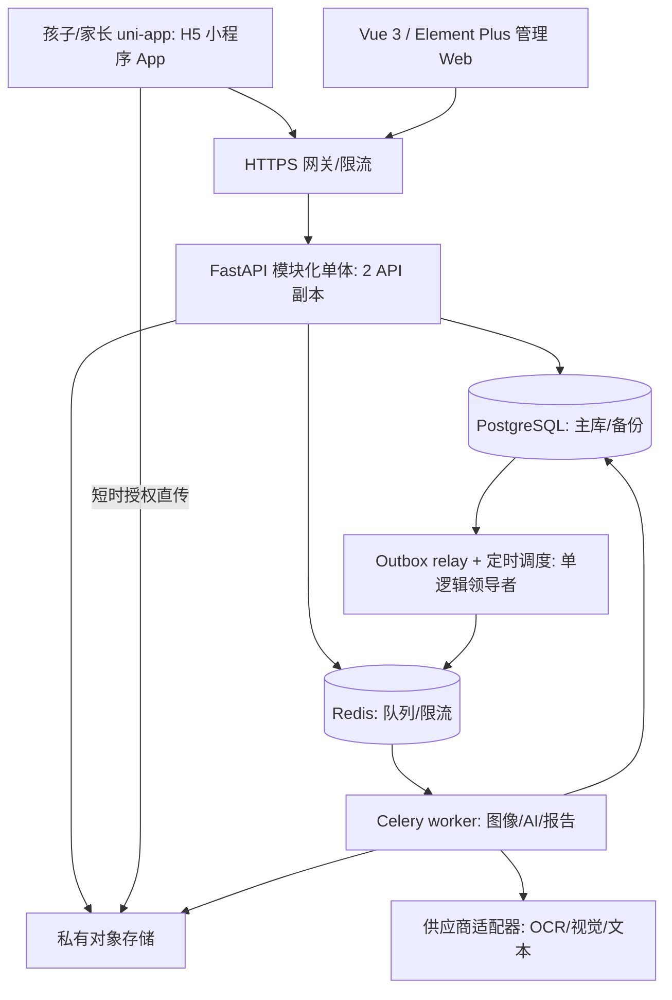

# 05 系统架构与技术决策

> 决策状态：建议采纳，需第 1～2 周 PoC 验证。业务规格以 [03](../03-software-requirements.md) 为准；所有容量是规划假设，不是压测成绩。

## 1. FastAPI 与 Go 的取舍

| 维度 | Python FastAPI | Go | 本项目判断 |
|---|---|---|---|
| OCR/模型/教研实验 | 可复用 Python 图像、评测与数据处理生态 | 云 API 调用同样可行；本地图像/评测工具往往另用 Python | 早期迭代重心是质量而非 HTTP 吞吐，选 Python |
| 并发与资源 | 异步适合等待 I/O；CPU 密集任务需进程/任务队列 | 轻量并发、部署二进制简洁 | 云模型等待占主导，两者都能满足首期规模 |
| 运维 | 需管理解释器、依赖及 worker 镜像 | 单程序部署较简单，异步长任务仍需持久队列/状态 | 不因语言删除任务可靠性设计 |
| 复杂度与团队 | FastAPI + SQLAlchemy + Alembic 一套业务代码 | 后端全 Go 可行，但不能预先再加 Python 微服务 | 已有成熟 Go 团队时可整套替换，不默认双语言 |

**ADR-01：选择 FastAPI 模块化单体。** Python 使用受支持稳定版本，依赖在第 1 周锁定，不在设计稿虚构“最新版本”。外部网络调用用有超时的异步客户端；Pillow/OCR/大图处理放 worker，不阻塞 API 事件循环。FastAPI 的 async 不是 CPU 并行承诺。[S15，见资料索引](../research/sources.md)

重新考虑 Go 的条件：实际峰值压测表明 API CPU/内存是主要成本，且 SQL、缓存和队列调优后仍无法达标，或团队 Python 维护能力不足。提案必须附瓶颈剖析与迁移成本，而非凭语言跑分拆服务。

### 前端决策 ADR-UI-01

- 平台：Vue 3 + TypeScript + Vite + Element Plus，按需引入组件；借鉴 Pure Admin/Vben 的管理模式，首版不复制完整框架仓库。家庭：uni-app Vue 3 + TypeScript，H5 与微信优先。
- 原型位于 `docs/prototype/ui`，Vue + Element Plus + Vant Web 构建至 `docs/prototype`；它是独立的前端演示，无真实业务 API。正式工程应复用布局、字段和交互规范，补齐类型、接口、错误态及真实授权。
- Vant Web 不作为小程序兼容性证明；跨端组件适配在第 1–2 周验证。路由/菜单可见性只控制呈现，API 与对象存储仍强制校验 tenant/student/action。
- 密钥仅在服务端凭据管理；PDF/OCR/模型评测使用后端异步任务，前端展示真实任务状态和证据。数据库保持 PostgreSQL，不因 UI 框架调整存储方案。

选型证据、替代方案与许可见 [UI 框架调研](../research/13-frontend-ui-framework-and-design-system.md)。

## 2. 总体拓扑

目标为同一仓库、同一后端构建产物，分别启动 api / dispatcher / worker / scheduler 进程，不拆为独立业务服务。当前已实现 API、outbox dispatcher，以及供 worker 集成的 DB 执行租约和模型调用围栏；尚无注册的批改消费者、真实提供方或 scheduler，见 [14](../plans/14-development-status.md)。管理后台与客户端使用不同鉴权受众。首期不需要 API Gateway 产品、消息中间件集群、服务网格或 GPU。

### 教材隔离接收、处理与正文发布（已实现至0028）

教材API先将PDF隔离接收到私有存储（0026），再显式登记PostgreSQL持久任务（0027）。独立`wizzy.textbook_worker`进程每次最多领取一项任务，经可信ClamAV服务扫描后，调用资源受限子进程检查PDF结构并提取内嵌文本；当前任务直接由PostgreSQL领取，不依赖Redis投递。扫描证据及逐页草稿保存在任务结果JSONB中。

API与worker分配不同受限数据库能力，无任务表直接访问权；180秒租约、随机令牌、最多三次领取及完成时授权复核约束并发和崩溃恢复。任务绑定教材权利修订和原申请会话，处理期间不持数据库连接或事务。前端分开读取状态与逐页正文，正文访问另需当前修订和preview授权。

ClamAV适配器在扫描前后检查病毒库日期，采用项目策略：最多72小时、允许未来5分钟。VERSION日期按`WIZZY_CLAMAV_DATABASE_TIMEZONE`解释（默认UTC，须与clamd时区一致），证据日期归一为UTC ISO格式；日期无效、歧义、过期、超前或扫描前后版本变化均拒绝提取。时效与协议边界已通过测试，真实引擎、自动更新/告警及Linux资源隔离部署仍待验收。

0027输出始终是待人工校核的内嵌文本草稿，不进行OCR或直接发布。0028新增`textbook_contents`当前状态与`textbook_content_revisions`不可变正文/操作历史，由API受限能力执行逐页校核、章节/物理源页映射、独立抽检、发布、TXT读取及撤回；worker无正文能力。所有写操作使用UUID幂等、CAS和事务内审计，审核人不得参与同一内容的创建、修订或提交。正文读取复核当前权利与storage/ocr/preview用途，发布及TXT另需retrieval用途；同一教材版本仅一份发布正文。人工确认不等于系统验证原PDF，原PDF预览、图片OCR与AI检索仍待实现。接收凭证的`not_scanned`不作为后续任务扫描结论。本地macOS没有地址空间内存上限。运行方法见[本地开发](../local-development.md)，数据/API契约见[06](06-data-model-and-api.md)，实施边界见[14](../plans/14-development-status.md)。

### 模块边界

| 模块 | 职责/拥有数据 | 不承担的职责 |
|---|---|---|
| identity/tenancy | 监护人身份、家庭、成员、儿童配对、同意记录 | 不给平台运营默认内容读取权 |
| media | 上传凭证、校验、净化、私有文件、保留期 | 不因知道 object key 就放行 |
| homework | 提交、页、题、版本、订正 | 不把模型回复直接写成最终成绩 |
| grading | 编排、规则、模型运行、风险与人工修正 | 不处理用户付费 |
| learning | 错题、复习任务、作答、掌握建议 | 不从已查看推断掌握 |
| curriculum | 学期、课表实例、教材章节与学习进度 | 不提供无授权教材全文 |
| reporting | 周/月汇总及可追溯源快照 | 不重新发明统计分母 |
| metering | 配额、预留、结算、供应商账单核对 | 不把未知扣费算作零 |
| platform | 元数据审核、配置发布、工单、审计 | 不绕过家庭隔离 |

模块通过应用服务调用及事务 outbox 事件协作，不为单次调用抽象“通用事件平台”。数据库为一个集群、按表与代码归属隔离；跨模块一致性由明确事务或有版本的派生任务保证。

## 3. 一次作业的可靠处理

以下为目标处理链路，当前已落地范围见本节后文；消费者、真实外呼、结果写回及成功配额结算尚未实现。

1. 家长/孩子鉴权后创建上传意图，服务端确定家庭及学生权限，返回仅对指定 key/类型/大小有效的短时凭证。
2. 客户端直传；`complete` 回调必须由服务端验证对象存在、真实格式、大小和解码像素上限。净化图片、剥除 EXIF，原上传隔离区不直接给模型或浏览器。
3. `POST /submissions` 用客户端幂等键；同一事务写提交、页、产品配额预留与 outbox。不在事务中等待模型。
4. relay 扫描已提交 outbox，投递 Celery，再标记。投递后标记前崩溃会重复投递，因此消费者仍要幂等，不能宣称 exactly-once。
5. worker 取得作业 ID、源版本和删除代次，从 DB 重载可信租户，先重新验证学生授权和同意状态。页面并行有总量上限；供应商并发有全局和每家庭配额。
6. 外呼前通过 `begin_call` 提交唯一 `model_runs` 调用围栏，取得 `run_id/operation_key` 后才允许发送；本地操作键不等于供应商幂等保证。初始 `billing_state=unknown`、金额 NULL，超时或提交回执丢失不得盲重发。当前 `finish_call` 仅记录调用结局及费用元数据；结果复用、供应商状态查询和账单对账仍是待实现目标。
7. 结构化校验、质量门禁后，以 `expected_revision` 条件写入结果；outbox 触发错题/报告更新。源版本过旧、人工结果已更新或删除代次变化，丢弃迟到结果并保留无敏感审计。
8. 任务到达终态结算产品额度，页失败部分返还；供应商实耗账另记，不能把用户退款当供应商没收费。

队列消息只放内部 ID、版本、删除代次与追踪标识，不放原图、签名 URL、手机号、题文。租户从数据库任务重载，不能仅信消息内容。

**2026-10-25 投递落地范围**：迁移 `0004_outbox_dispatch`、`wizzy.dispatch` 和 `wizzy.broker` 已实现独立无表权限账号通过受限 SECURITY DEFINER 函数发现/结算事件；60 秒租约、SKIP LOCKED 抢占、事务提交后发布、错误退避封顶 300 秒。JSON 参数固定为 `event_id`、`job_id`、`source_revision`、`deletion_epoch`、`request_id`，不传租约 token 或 tenant_id。成功发布不改变 queued/额度预占，仍符合 queued 发现条件且无调用记录时，300 秒后允许 DB 驱动重放；重复消息与发布后崩溃均可能发生。迁移 `0005_execution_leases` 已实现 DB 执行去重、租约、心跳与外呼前有限恢复；`0006_provider_call_fences` 已实现一次性调用许可和仅账务回执，两者均有真实 PostgreSQL 测试。有任何调用记录的事件均禁止 release/reclaim/恢复投递，即使费用已知或租约过期；仅原有效执行租约可在既有调用成功且费用已知后取得未调用阶段的许可。消费者注册、真实外呼、结果写回和成功额度结算仍未实现，不能以投递或调用元数据通过代替整条链路验收。命令、配置与验证边界见 [本地开发指南](../local-development.md)。

### 重试、取消与补偿

- 当前最多 3 次执行尝试仅用于**尚无调用围栏的外呼前中断**，不代表模型 HTTP 可重试 3 次。`begin_call` 提交后，网络失败、429/5xx 或超时均不得直接 release/重发；即使提交成功后尚未发送便崩溃，也保守停住。未来提供方适配器须关闭 SDK 自动重试；仅在供应商明确幂等与费用证据通过独立验收后另定恢复策略。**质量复核最多 1 次、JSON 修复最多 1 次**是目标业务操作，不是重复付费调用的豁免，详见 [04](../04-ai-grading-and-evaluation.md)；当前围栏并未实现完整阶段顺序或这些业务流程。
- 目标为每次外呼预算预留；总时间预算建议单页 180 秒，90 秒是正常清晰页 P95目标，不承诺所有任务90秒结束。超时待确认而不强行猜答案；当前尚未实现外呼预算预留或 pending 业务状态。
- worker 集成目标为维护租约/心跳和阶段检查点；当前 DB 仅允许无调用记录的过期执行恢复。有调用记录则停住待对账，自动对账/运维解锁尚未实现，也没有额外写入 pending 业务状态。Redis 丢失时只能重投符合 DB 围栏条件的事件，不让 Redis 成为唯一作业事实来源。
- 任务取消是协作式；已发送的供应商请求不保证撤回。取消/删除后禁止写回/泄露结果，费用核对独立完成。
- deadletter 目标记录错误类别/重试数/配置版本，不含作业全文。运营重试应创建经审核的新操作版本，不清空历史；当前尚无运维重试/解锁入口，不得通过换版本或删除调用记录绕过费用围栏。

Celery 配置需结合 ack、超时、幂等任务一起测试，不能只打开 `acks_late` 就宣称不会丢任务。[S17](../research/sources.md)

## 4. 租户与数据库边界

详细 SQL 见 [06](06-data-model-and-api.md)。API 从令牌主体→有效家庭成员关系→被授权学生建立上下文；客户端 `tenant_id` 不能决定权限。平台受众不能调用家庭内容 API。

- 所有家庭业务行带非空 tenant_id；关联用 `(tenant_id,id)` 复合外键，阻止跨家庭拼接。
- RLS 作纵深防御，应用非表 owner、非 superuser、非 BYPASSRLS，启用 FORCE；学生范围还须应用级授权，家庭 RLS 不自动隔离兄弟姐妹。
- 每事务 `set_config(..., true)` 设置上下文；退出事务清理。回连接池、异常回滚、并发请求必须实测不串租户。
- 共享教材表仅放已授权公共元数据；含个人笔记、学习进度、页截图的表仍是家庭表。
- Redis/cache key 带 tenant/student/source_revision；对象 key 随机且分家庭。签名访问先鉴权、有效期建议≤5分钟，日志不落 query string。

## 5. 部署与容量起点

| 环境 | 起始资源建议（非采购承诺） | 说明 |
|---|---|---|
| 本地目标拓扑 | Docker Compose: API/worker/PG/Redis/兼容 S3 存储 | 当前 Compose 已启动 PG/Redis，API/dispatcher 可宿主机运行；worker/scheduler/对象存储服务尚未落地。自动化使用合成测试数据，不测模型准确率 |
| 预发布 | 与生产同拓扑缩容、独立密钥与库 | 锁定测试集受控访问；不可复制生产全库 |
| 试点生产 | API 2×2vCPU/4GiB；worker 合计4～8vCPU/8～16GiB；托管 PG/Redis/对象存储 | 选择服务商与可用区后询价和压测；资源不等于99.5%保证 |

容量假设：1,000活跃学生×22天×2页=44,000页/月；晚高峰集中、日均不代表峰值。压测初始 100 个并发在线用户、20 个并发上传、10 个并发页面任务，随后按试点实测到达率与供应商配额调整。外呼并发建议起始5～10，可配置但不能突破预算和供应商限流。

容量初估用利用率 `ρ = 到达率 λ × 平均服务时间 E[S] / 并发 c`，各时间单位保持一致；这是无量纲利用率，**不是平均排队等待秒数**。ρ接近1时延迟风险显著增大，突发/长尾和外部限额也会排队；等待时间需用实际流量仿真/压测，验收测含排队的 P95。worker 按队列深度/最老任务等待扩容，最高副本限制阻止成本失控。队列分交互批改与低优先周报，报告不得挤占晚高峰。

## 6. 交付与可观测性

- 当前工程：`backend/src/wizzy/{identity,security,media,submissions,bootstrap,db,errors,config,main}.py`、`backend/migrations`、`backend/tests`；依赖锁在 `backend/uv.lock`。原型在 `docs/prototype/ui`。后续按边界追加 grading/learning/curriculum/reporting/metering/platform；`clients/family`、`clients/admin` 与完整部署仍待实现，不另建重复的 `backend/app` 目录。实施证据见 [14](../plans/14-development-status.md)。
- CI：类型/静态检查→单元→PostgreSQL真实集成/RLS→契约→合成E2E→依赖及密钥扫描；模型评测单独受控，不默认每次 PR 消耗真实儿童数据和付费 API。
- 镜像不可变版本、依赖锁定、Secrets Manager/环境注入；不把密钥打入前端。迁移采用扩展→应用切换→后续收缩，不能用回滚旧镜像解决破坏性迁移。
- metrics：API P95/5xx、排队年龄、页成功与 pending、各阶段时延、供应商429/超时、已预留/实耗/未知费用、删除积压、越权拦截；指标不得按儿童姓名打标签。
- trace_id 贯穿 API→outbox→worker→model_run；审计记录操作者/权限来源/对象ID/动作/版本，不记录完整题目或令牌。
- 备份恢复、事故处置与上线硬门禁见 [11](../11-test-acceptance-and-operations.md)。

## 7. 不做和后续扩展

P0 不做：多语言微服务、独立搜索集群、向量库、自动题库爬取、自建训练、跨地域双活、复杂推荐。P1 工整度、打印、App 沿模块扩展。P2 机构租户需重新定义学校/家庭间授权、数据控制者责任和计费，不能简单给机构账号加 `tenant_admin`。
