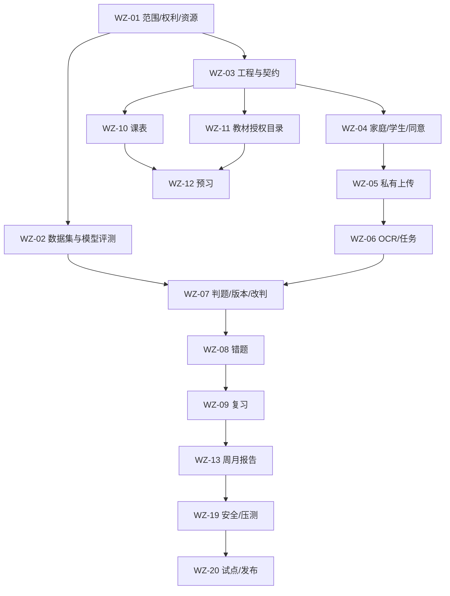

# 10 分阶段实施计划

> v1.0｜2026-10-25｜这是后续开发执行计划，不是已完成的软件进度。周期以人员、教材/试点授权和评测资源到位之日为第 1 周，不假设今天立刻开工。需求以 [03](../03-software-requirements.md) 为准，任务与验收映射见 [12](12-backlog-and-traceability.md)。

## 1. 交付目标与不可压缩项

12 周的主目标：H5/微信小程序完成“监护授权 → 拍照 → OCR/数学白名单批改 → 家长核对 → 错题订正 → 周/月复习 → 课表与预习”闭环，以及可独立运行的平台管理端。完成家庭隔离、删除、账单和恢复演练后，再由产品、教研、安全和合规分别决定试点/上线。

- 第 8 周是业务闭环 alpha，**不是完整 P0 已验收或可公开经营**；第 9～10 周用于完整性、性能、安全与容灾，第 11～12 周受控试点。
- Android/iOS 为 P1：可在第 9～12 周做构建和真机验证，但仅在 P0 余量、资质和开发者账号齐备时追加；不承诺同期上架。
- 工整度、多轮辅导、变式、打印、扩学科等 P1 独立排期，不把全部 P1 塞进 12 周。
- 题型达不到评测门禁时缩小自动放行白名单，保留待确认和监护人确认；不能靠降低准确率门槛按时上线。若最低可用覆盖仍不达标，延期或取消自动判题。
- 不省略监护同意、隔离、授权教材、删除、真实账单验证，不通过“先上线再补”转移风险。

## 2. 人员、职责及容量

| 角色 | 配置 | 主责及交接 |
|---|---|---|
| 产品/项目负责人 PM | 0.5～1 人，负责人明确 | 范围、家长访谈、周验收、预算、外部审核；不能替代法务/教研签字 |
| 后端 BE1 | 1 人 | FastAPI、身份/家庭/RLS、业务数据、报表、删除；复核 BE2 的授权与幂等 |
| 后端/AI BE2 | 1 人 | OCR、模型适配、评测、队列、成本；复核 BE1 的不可变版本与异步一致性 |
| 前端 FE1 | 1 人 | uni-app 孩子端、相机/上传、结果/复习与多端适配 |
| 前端 FE2 | 1 人 | 家长端、管理 Web、契约联调与可访问性；与 FE1 共享组件而非复制权限判断 |
| QA | 1 人 | 用例/自动化、隔离攻击、真机、故障及恢复；测试可从第 1 周开始 |
| 教研 EDU | 指定负责人 + 标注资源 | 题型边界、双标/仲裁、教材映射、提示量表；金标准与线上改判分开 |
| 运维 OPS | 兼职，约 0.2～0.4 人 | 环境/密钥、监控、备份、恢复、上线和值班；工作量不能隐含为零 |
| 安全/法务 SEC/LEGAL | 关键节点外部或内部支持 | 供应商合同、儿童数据、教育功能分类、教材/品牌/发布资质；独立阻断权 |

按每周 5 个有效工作日估算：BE 120、FE 120、QA 60，共 **300 人日名义容量**。P0 任务合计 BE **102**、FE **84**、QA **45**，共 **231 人日**；名义余量 18/36/15，共 69 人日。此余量覆盖缺陷、评测返工、跨端差异、协作和不确定性，**不是可自动承诺的新功能工时**。未计法定假期、请假、评审及行政等待；实际开工必须按日历重排。

### 教研资源是独立关键路径

评测集如取 10,000 题、每题每人 0.5～1.5 分钟、两人独立标注，约需 **167～500 小时（21～63 个 8 小时人日）**，尚不含征集同意、脱敏、仲裁、版本整理。复杂应用题更耗时；这些不是上表 QA/BE 工时可代替的。兼职教研若无法承担，须增加合格标注资源、缩小首发题型并保留统计功效，或延长项目周期；不能用同一模型自标自验。

## 3. 依赖与并行安排



图仅展示业务主依赖。WZ-14 费用账本必须在首次付费外呼前可用；WZ-15 管理审计、WZ-16 删除贯穿开发；WZ-17 多端验证与 WZ-18 部署恢复从早期开始。依赖不是要求前一个任务 100% 完成才能设计后一个：先冻结小范围接口、用合成数据联调，**未经授权不为赶进度接真实儿童图像**。

## 4. 12 周执行表

| 周 | 后端/AI | 前端/管理台 | QA/教研/外部 | 本周可验收交付 |
|---|---|---|---|---|
| 1 | WZ-01/02/03：范围、数据协议、评测骨架、身份/任务契约 | 相机上传最小真机 PoC、角色导航、关键页面低保真 | 同意/教材/供应商清单；建立风险集与验收用例 | 冻结首发年级/题型、样本合法来源；H5/微信各拍摄上传合成页 |
| 2 | WZ-02/04/14：候选模型同集试验、家庭/RLS、外呼费用记录 | 登录/家庭/配对、上传草稿 | 基线评测、越权用例、价格实测；合同与账号确认 | G1 技术可行性；不能只做模型演示 |
| 3 | WZ-04/05/06：对象上传闭环、任务/outbox、OCR | 拍摄裁剪、进度/取消/重试、原图框选 | 授权全矩阵、恶意图/断网/重复上传 | 私有图像→OCR 可恢复，删除后旧任务不能写回 |
| 4 | WZ-06/07/14：分题、规则/视觉、结果版本、预算 | 分题结果、待确认、家长识别修正 | 错位/涂改/印刷答案集；并发改判/重复收费 | G2 单页闭环；原结果与人工修正不覆盖 |
| 5 | WZ-07/08：订正、错题去重、筛选、掌握历史 | 错题/原图/订正页面、静态分级提示 | 错题关联与二次判定回归 | 从原始错题到订正，可追溯每次尝试 |
| 6 | WZ-09/10/11：复习调度、课表、合法教材目录 | 复习作答/退出恢复、课表编辑、教材管理 | 跨周/月及调课；双人教材发布 | D+1/3/7/14 计划与课表；无权正文不能发布 |
| 7 | WZ-12/13/15：预习、周月结构化报告、平台控制 | 首页、预习卡、家长汇总、模型/任务/用量管理 | 报告分母、空周期、改判重算、到期授权 | 报告下钻对账；明日章节须家长确认 |
| 8 | WZ-13/16：删除导出、供应商回执、剩余联调 | 隐私入口、全旅程、空态/错误态与退出清理 | 全链路 alpha、模型锁定评测预跑 | G3 业务闭环 alpha；不是上线签字 |
| 9 | WZ-17/18/19：并发/限额/告警、备份恢复 | H5/微信兼容/无障碍；有余量才开 App 构建 | 高峰配额、删除竞态、消息重复/worker 崩溃 | 性能与可靠性问题清单；恢复证据 |
| 10 | WZ-19：安全修复、锁定模型/Prompt、账单核对 | 真机矩阵、低端机/弱网、管理端权限 | 不可见锁定评测、隐私/资质/权利签字 | G4 试点准入；不达标不邀新家庭 |
| 11 | WZ-20：受控灰度、值班与费用/质量观察 | 试点问题修复、家长操作引导 | 先 5～10 个已授权家庭，再按门禁扩大 | 分层质量、待确认负担、账单、用户反馈 |
| 12 | WZ-20：扩大至 50～100 家庭或停止、回滚演练 | P0 收尾；App 满足独立门禁才交付候选包 | 最终签字；P1 逐项评估，不追求全部完成 | G5 有条件发布决定、交接手册与下一周期计划 |

**工时平衡说明**：表中是主题，不是每日派工；跨周任务可重叠。每周滚动维护角色剩余人日及关键依赖，BE2 同时承担评测和队列时优先保证关键路径，不给同一人安排两个满负荷任务。

### 前端商业化 UI 工作包（纳入现有 FE1 / FE2 容量）

[交互原型](../prototype/README.md) 是设计和字段基线，尚未完成正式业务开发。沿用 [UI 决策](../research/13-frontend-ui-framework-and-design-system.md)，不另起一套脱离现有 12 周计划的框架工程。

| 时段 | FE1 家庭端 | FE2 平台端 | 可验证产物 |
|---|---|---|---|
| 1–2 周 | uni-app 组件适配、拍照上传/弹层/表单在 H5 与微信真机验证 | Vue 3/TS/Vite/Element Plus 壳、设计 token、中文组件、许可清单 | 跨端能力记录；冻结状态语义与接口类型；不能用 Vant Web 替代真机结果 |
| 3–6 周 | 作业/核对/复习/课表真实接口、OCR 题块定位、上传恢复 | 租户/学生/任务筛选及服务端分页、详情、权限呈现 | 空/加载/失败/无权限/409 状态；服务端权限拒绝证据 |
| 7–10 周 | 报告、监护人授权撤销、隐私请求状态 | 模型注册/版本评测/审批与回滚，教材解析/抽检/发布，RBAC/MFA | 状态机与审计链闭环；模型和教材发布不能由演示按钮代替 |
| 11–12 周 | H5/微信真机、触控/读屏、断网恢复、受控试点 | 键盘/读屏、长列表性能、生产构建体积优化、安全回归 | 逐需求验收记录与回滚方案；失败项单列 |

学校管理和原生 App 保持 P1，独立排期；原型已经展示不代表纳入 P0 交付。原型当前主 JS 略超 Vite 500KB 提示阈值，正式工程需按路由/组件依赖评估拆分并测量首屏性能，不能通过提高阈值冒充优化。

## 5. 五个决策门

| 门禁 | 必要证据 | 决策人与失败处理 |
|---|---|---|
| G1 第 2 周 | 初步同集准确率/误判正确/覆盖/耗时/成本；真实设备拍照；样本/供应商路径可行 | PM+EDU+BE2+LEGAL；不可信则换供应商/收窄白名单/延期，不开始大规模页面扩展 |
| G2 第 4 周 | 一页作业可追溯；pending、人工改判、并发预算、删除防复活通过 | BE1+QA；数据/授权错误先停联调修复 |
| G3 第 8 周 | P0 全旅程可演示，任务/测试映射无遗漏，接口错误态齐全 | PM+QA；未完项明确负责人和剩余工时，不标成已交付 |
| G4 第 10 周 | [11](../11-test-acceptance-and-operations.md) 全部 P0 准入：锁定集统计门禁、零未关高危漏洞、恢复、账单、合规签字 | QA/EDU/SEC/OPS/LEGAL 分别签字；任一关键项失败不开真实公测 |
| G5 第 12 周 | 试点指标、事故和费用趋势、家长确认负担、发布/回滚记录、支持能力 | 负责人作 go/no-go；技术通过不代替教材/法定审核；不满足继续封闭试点或停止 |

小规模试点观测不能替代离线锁定集，也不足以宣称普适学习效果。验收目标见 `04/11`，本计划不以“模型两次一致”替代评测门禁。

## 6. 开发落地顺序与工程产物

### 首日 / 第 1 周清单

1. PM 记录假设：试点一个年级/教材版本、数学首发题型、每月预算、渠道、保留期、可接受待确认率；没有答案则采用 `01` 默认并列风险。
2. LEGAL/EDU 确认样本和教材来源、监护授权、候选供应商可接受地域/训练用途/保留与删除条款；只用合成/已合法授权数据开始。
3. BE1 建服务骨架、数据库迁移、契约测试与租户授权；BE2 建独立评测目录、模型适配协议和费用记录。禁止模型密钥下发前端。
4. FE1 在微信开发工具及真机/H5 做相机→私有上传→进度恢复最小实验；FE2 建角色路由与最小管理壳。
5. QA 建 T01～T29 测试清单、造数与双家庭/多学生 fixture，至少一条跨租户拒绝测试进入 CI。
6. OPS 建 dev/staging/prod 隔离、私有存储、凭据管理、预算告警；prod 尚不对公众开放。
7. 周末产出：版本化接口草案、2～3 家供应商评测计划、阻断清单、Week 2 负责人任务板，不用空页面截图当作业务完成。

### 拟建代码目录（当前没有实现这些文件）

```text
services/backend/
  app/api/            # FastAPI，依赖注入和权限上下文
  app/modules/        # identity/family/homework/mistakes/review/curriculum/report/admin
  app/ai/             # provider adapters、schema、rules、versioned prompts
  app/jobs/           # Celery、outbox、leases、scheduler
  app/infra/          # DB、private storage、redis、metrics
  migrations/         # 包括非 owner 角色与 RLS
  tests/              # unit/integration/authorization/contract
clients/family/       # uni-app，孩子/家长角色分区
clients/admin/        # 独立 Web 管理台
quality/evaluation/   # 评测代码、manifest/版本；不提交原始儿童图像
ops/                  # dev compose、部署/监控/备份配置
```

采用一个仓库、共享 OpenAPI 类型。先建立最小可用依赖集合和锁文件，具体稳定版本于开工时核验并固定；不复制“最新”浮动依赖。SQL/接口样例位于 `06`，实现时迁移、约束、RLS 和完整错误 schema 由自动化测试验证。

### 每张开发票据的完成定义（DoD）

- 关联需求 ID、任务 ID、测试 ID，说明允许/拒绝路径及用户状态；不靠口头“做好了”。
- 数据迁移可演练，跨家庭与同家庭学生权限有测试；异步任务继承授权和删除 epoch。
- 接口与前端生成类型一致，错误码、重试、空态、埋点无内容泄露；非必要埋点不采集。
- 普通逻辑/授权/幂等测试进入 CI；涉及模型的变更跑锁定版本评测且记录 token 和费用。
- 不含密钥/原始作业；第三方许可、SDK 隐私与内容授权记录完整。
- staging 演示成功，QA 附证据；有监控和回滚方式。尚未通过真机/法务/模型门禁的部分明确“不通过”，不合并为已验收结果。

## 7. 风险登记与止损

| 风险 | 早期信号 | 负责人/措施 |
|---|---|---|
| 手写/切题误差使准确率不可用 | OCR 易混数字、跨题抄答案、误判正确高 | BE2+EDU；先单一数学题型，增样/重拍/pending，必要时停自动判题 |
| 合法样本/教研不足 | 第 1 周无授权集、双标排不上 | PM+EDU；资源补齐或延期；不采爬儿童数据补数 |
| 教育/AI/儿童/出版等分类不清 | 外部审核无明确路径 | LEGAL；限制合法测试范围或暂停，无“改UI绕过”方案 |
| 供应商变价/别名漂移/配额受限 | 同图结果波动、版本变动、晚高峰429 | BE2+OPS；固定版本/回归、限流、待确认；备用供应商也要先过门禁 |
| 家长确认负担太高 | pending 多、复核放弃率高 | PM+EDU；优化拍照/切题、收窄白名单、验证真实价值，不伪造正确率 |
| 跨端适配消耗余量 | H5相机不一致、微信上传中断、App SDK差异 | FE1；先保障 H5/微信，App 独立验收顺延 |
| 隔离/删除/重试造成泄露或重复费用 | 越权、旧回调复活、供应商重复账单 | BE1+QA；对应用例前置；严重事件停外呼/停发布 |
| 12周容量不足 | 任一角色剩余工时连续两周超可用 | PM；先减 P1/题型，不减安全；重排日期并告知 |

## 8. 试点与交接

- 试点招募需监护人明确同意，解释 AI 可能错误、哪些题不支持、如何改判及删除；不以免费奖励换取不必要训练授权。
- 先 5～10 家庭验证运营与安全，再在无阻断问题且有值班资源时扩大至 50～100；1,000 学生只是首期容量规划，不是 12 周获客承诺。
- OPS 接收：部署/回滚、model release manifest、配额/供应商联系人、备份恢复记录、费用看板和事故级别；客服只用最小元数据工单。
- EDU/PM 接收：白名单、评测报告、已知缺陷/不支持题型、家长引导材料、合规/教材授权到期日和下一版任务。
- 交付包里将“已实现”“已验证”“待审核/待验证”分别列表；任何准确率、性能与成本指标都附测试版本、时间、样本和分母。
