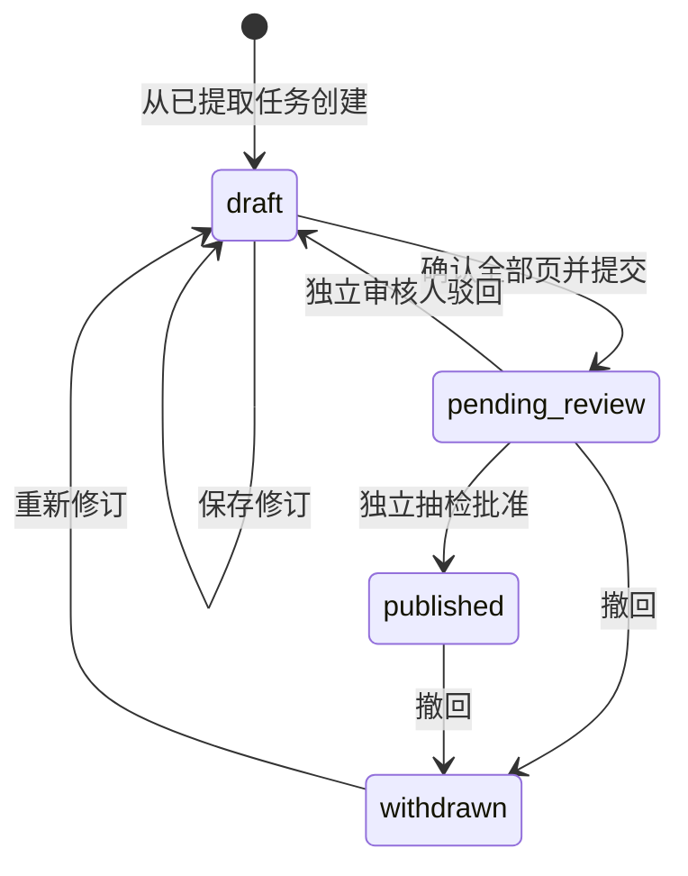

# 教材正文校核、独立抽检与发布

日期：2026-10-26。接续0025权利审核、0026隔离接收和0027持久处理任务；本记录对应正式平台与后端，不是模拟原型的验收声明。

## 本次范围与假设

- 数据库继续采用PostgreSQL，代码迁移head为`0028_textbook_content`；本轮仅在随机隔离库验证，未升级、重置或重新读取共享开发库，未修改真实凭据。
- 从`draft_ready`任务创建人工校核内容，保留原PDF物理页号。输入是0027提取的内嵌文本；图片型PDF的OCR仍待开发。
- 正式平台提供逐页文字编辑和确认、章节层级及页码范围、保存、提交、独立抽检批准或驳回、发布TXT下载、撤回与不可变历史。
- 人工确认和抽检勾选记录人工声明。已补授权原PDF单页预览及桌面并排校核，不能据此宣称系统自动验证了文字与原件一致。TXT发布也不代表AI索引或检索已接入。

## 开发与验收步骤

1. 新增正文头/不可变修订及受限数据库能力；验证迁移往返、事务失败回滚、RLS/ACL及历史保留。
2. 接通正文API与正式平台校核工作区；验证版本、幂等、独立审核、必抽页、权利失效、发布唯一性与审计原子性。
3. 完成API单元、模拟浏览器交互、类型/构建、后端完整回归与文档核对；分别记录真实数据库验证和模拟浏览器验证的边界。

## 数据与权限

| 对象 | 已实现约束 |
|---|---|
| `textbook_contents` | 绑定来源任务、教材及权利修订，保存创建人、当前内容修订与状态；每个来源任务只对应一份内容 |
| `textbook_content_revisions` | 追加正文JSONB、状态、动作、操作者、提交人、原因、原请求与抽检页；内容/修订唯一，操作者/操作UUID唯一；禁止更新、删除及清表 |
| 当前修订外键 | 延迟校验内容头的修订与状态必须对应同一条修订历史 |
| `textbook_content_request` | API专用受限能力；FORCE RLS，两表对API、worker及dispatcher均不授予直接CRUD，worker/dispatcher不可执行该能力；辅助函数撤销PUBLIC执行权并固定search_path |
| 平台权限 | 元数据与正文读取需`platform.textbooks.read`，创建/修订/提交/撤回需`platform.textbooks.write`，批准/驳回需`platform.textbooks.review` |
| 审计与降级 | 每次内容变更与`textbooks.content.*`审计同事务落库；正文或对应审计存在时拒绝破坏性降级 |

正文、历史正文和TXT读取均复核当前教材权利修订，以及有效`storage/ocr/preview`用途；发布与TXT另需`retrieval`。权利失效后元数据仍可读取，有写权限者仍可撤回待审或已发布正文。`content_available`仅表示当前已发布正文满足检索授权，不表示已存在AI索引。

## 正文与章节契约

- `body.pages`按1起始连续排列，共1–500页，数量与来源一致。每页含`number/text/verified`，`verified`为严格布尔；每页最多100000个Unicode字符，总计最多1000000字符，拒绝NUL与孤立代理字符。
- `body.chapters`最多500项，包含`code/title/parent_code/first_page/last_page`。代码匹配`[A-Z0-9][A-Z0-9_-]{0,39}`且唯一；标题1–200字符，无首尾空白和控制字符；无父章节时显式传`null`。
- 父章节须先列出，子章节页码范围须在父章节内，所有页码须在来源范围内。提交时必须有章节并联合覆盖全部源页、所有页面已确认，且整本至少包含一个非空白字符；空白按Unicode规则识别，来源空页可人工确认保留。
- 必抽页包括首末页、来源提取为空的页、所有与来源文字不同的页。`sample_pages`须不重复、范围有效并覆盖全部必抽页。
- 页码是PDF物理页，不是书本印刷页。TXT以`[PDF page N]`保留页边界；章节结构随接口JSON另行返回，不宣称已实现公式/表格结构化识别。

## 状态与审核

审核人不能参与同一内容的任何创建、修订或提交，检查完整历史贡献者，而非只检查最后编辑者。批准要求当前有效检索授权，并复核必抽页；同一教材版本最多一份已发布正文，替换前必须先撤回旧内容。已发布内容不能直接改写，修订须先撤回。

所有写操作包含`operation_id` UUID、`expected_revision`及1–500字符`reason`。创建时版本指教材权利修订，其余指内容修订；实时身份/权限优先于幂等回放。相同操作者同键同体返回原结果，异体返回409；CAS冲突不产生新正文或部分审计。前端对结果不确定的请求冻结原UUID与完整请求体，重试不生成新操作键。

## API 与正式平台入口

统一前缀：`/api/v1/admin/textbook-editions/{edition_id}`。完整字段及错误边界见[数据模型与API](../architecture/06-data-model-and-api.md)。

| 方法与相对路径 | 行为 |
|---|---|
| POST `/processing-jobs/{job_id}/content` | 从提取完成任务创建待校核草稿；初始页面未确认、无章节 |
| GET `/contents` | 按来源创建时间/ID游标分页，limit 1–100 |
| GET `/contents/{content_id}` | 读取状态、版本、贡献者、必抽页等元数据 |
| GET `/contents/{content_id}/history` | before修订号/limit分页读取历史元数据 |
| GET `/contents/{content_id}/revisions/{revision}/body` | 在当前权利许可下读取指定历史正文 |
| GET `/contents/{content_id}/revisions/{revision}/pages/{page_number}` | 读取指定修订单页 |
| POST `/contents/{content_id}/revisions` | 保存完整正文及章节的新修订 |
| POST `/contents/{content_id}/submit` | 提交独立审核 |
| POST `/contents/{content_id}/approve` | 提交抽检页并批准发布 |
| POST `/contents/{content_id}/reject` | 驳回为草稿 |
| POST `/contents/{content_id}/withdraw` | 撤回待审或已发布内容 |
| GET `/contents/{content_id}/txt` | 当前发布版本的TXT内容和章节；返回JSON，由前端生成下载文件 |

正式平台从教材文件的处理任务中显式打开校核工作区，先列出已有内容，再创建或打开草稿。文字修改清除该页确认，未保存修改须保存或显式放弃后再切换；独立审核人逐页读取并勾选抽检。历史正文只读，下载仅用于当前发布内容。401/403或权利冲突清理已加载正文；迟到响应不能恢复旧正文。正文不写入localStorage，390px布局已有模拟浏览器覆盖。

关键文件：

- 迁移：[0028_textbook_content.py](../../backend/migrations/versions/0028_textbook_content.py)。
- API：[textbook_content.py](../../backend/src/wizzy/textbook_content.py)，在[main.py](../../backend/src/wizzy/main.py)注册。
- 单页预览：[pdf_preview.py](../../backend/src/wizzy/pdf_preview.py)、[pdf_render.py](../../backend/src/wizzy/pdf_render.py)、[预览接口](../../backend/src/wizzy/textbook_processing.py)与[TextbookPdfPreview.vue](../../frontend/platform/src/TextbookPdfPreview.vue)。
- 前端：[TextbookContent.vue](../../frontend/platform/src/TextbookContent.vue)、[TextbookProcessing.vue](../../frontend/platform/src/TextbookProcessing.vue)及[api.ts](../../frontend/platform/src/api.ts)。
- 后端验证：[单页渲染测试](../../backend/tests/test_pdf_preview.py)、[预览授权测试](../../backend/tests/test_textbook_preview.py)、[内容API测试](../../backend/tests/test_textbook_content.py)、[内容迁移测试](../../backend/tests/test_textbook_content_migration.py)。
- 前端验证：[API单元测试](../../frontend/platform/tests/api.test.mjs)、[校核浏览器测试](../../frontend/platform/tests/textbook-content.spec.ts)。

## 正文发布初次验证结果（2026-10-26，预览增量前）

| 检查 | 命令 | 本轮结果与日志 |
|---|---|---|
| 内容API/内容迁移/处理迁移专项 | `backend/.venv/bin/pytest backend/tests/test_textbook_content.py backend/tests/test_textbook_content_migration.py backend/tests/test_textbook_processing_migration.py -q --tb=short` | 24 passed，1 warning（19.12s）；`/tmp/wizzy-content-tests-current.log` |
| 后端完整回归 | `backend/.venv/bin/pytest backend/tests -q -x --tb=short` | 1265 passed，2 skipped，1 warning（271.95s），退出码0；`/tmp/wizzy-backend-0028-full.log` |
| 后端静态检查 | `backend/.venv/bin/ruff check backend` | All checks passed；完整回归后复核通过 |
| 平台API单元 | `npm --prefix frontend/platform test` | 68 passed；`/tmp/wizzy-platform-unit-current.log` |
| 平台类型检查/生产构建 | `npm --prefix frontend/platform run build` | 通过（Vite 3.54s），有大于500kB分包提示；`/tmp/wizzy-platform-build-current.log` |
| 正文模拟浏览器专项 | `PLAYWRIGHT_CHANNEL=chrome npm --prefix frontend/platform run test:browser -- tests/textbook-content.spec.ts` | 7 passed（5.8s）；`/tmp/wizzy-content-browser.log` |
| 全平台模拟浏览器交互 | `PLAYWRIGHT_CHANNEL=chrome npm --prefix frontend/platform run test:browser` | 107 passed（6.4m）；`/tmp/wizzy-platform-browser-current.log` |

后端测试使用随机隔离PostgreSQL库与受限角色，包含真实SQL/迁移/并发与审计回滚检查。表中的1265/2 skipped是新增教材真实浏览器测试前的历史完整回归；真实浏览器需显式设置`WIZZY_BROWSER_TESTS=1`。后续已单独执行0028真实API浏览器联调：`WIZZY_BROWSER_TESTS=1 PLAYWRIGHT_CHANNEL=chrome backend/.venv/bin/pytest backend/tests/test_textbook_content_web.py -q --tb=short`，1 passed、1 warning（8.80s），日志`/tmp/wizzy-textbook-real-browser.log`。三个账号完成登记/独立权利审核、3页PDF上传、worker提取、逐页正文和两级章节、独立抽检发布、只读TXT下载及撤回；真实数据库确认五版不可变正文、操作者、源SHA256与五条审计，浏览器pageerror为0。扫描器显式注入`CleanForTest`，不算真实ClamAV验收。修正测试中的教材状态查询（连接当前修订）和接收状态断言（`quarantined`）后，内容/迁移专项再次24 passed、1 warning（10.98s），日志`/tmp/wizzy-content-tests-real-web-followup.log`；Ruff及浏览器脚本语法检查通过。表中107项Chrome测试仍是模拟API，与本次真实链路分别记录。warning是既有Starlette/httpx弃用提示；平台构建JS为513.24kB，保留分包提示待后续性能优化。

为兼容新head，历史迁移测试中“升级到最新版本”的断言已更新至0028；专门验证0027往返的测试及0028的前序版本仍保持0027。

## 授权单页 PDF 预览增量（2026-10-26）

正式平台已提供原件与正文并排校核；1100px及以下改为上下布局，支持放大、适合宽度、加载失败重试。当前页按需读取，切页或卸载时取消请求并释放Blob URL；旧响应不能覆盖当前页。401/403、权利失效或来源不一致时清理正文和预览。真实长教材编号曾使390px页面横向溢出，已为教材工作区卡片设置`min-width:0`，并使用长编号固定回归场景。

新增`GET /api/v1/admin/textbook-editions/{edition_id}/documents/{document_id}/processing-jobs/{job_id}/pages/{page_number}/image`，返回当前页PNG。渲染前后复核会话、权限、教材权利修订、来源任务与文件元数据；校验私有源文件大小及SHA-256，临时私有快照在完成后删除，原生解析在受限子进程中执行，并限制并发、超时、图片尺寸和返回字节数。响应使用`private, no-store`和`nosniff`。前端另校验PNG签名、IHDR及尺寸/大小，不提供整本原PDF下载接口。此增量沿用0028，无新增数据库迁移。

| 检查 | 结果与日志 |
|---|---|
| 平台API单元 | `npm --prefix frontend/platform test`：75 passed；`/tmp/wizzy-preview-api-unit-final.log` |
| 后端单页渲染、授权与正文专项 | `backend/.venv/bin/pytest backend/tests/test_pdf_preview.py backend/tests/test_textbook_preview.py backend/tests/test_textbook_content.py -q --tb=short`：32 passed、1 warning（8.83s）；`/tmp/wizzy-preview-backend-final.log` |
| 全平台模拟浏览器 | 114 passed（5.7m）；`/tmp/wizzy-preview-platform-browser.log`。在最后一次教材卡片CSS修复前执行 |
| CSS修复后教材模拟浏览器 | `textbook-content.spec.ts`、`textbook-documents.spec.ts`、`textbook-processing.spec.ts`合计33 passed（13.1s），其中正文/预览14项；`textbook-catalog.spec.ts`另14 passed（9.7s），共47项；`/tmp/wizzy-preview-textbook-browser-final.log`、`/tmp/wizzy-preview-catalog-browser-final.log` |
| 真实API/隔离PostgreSQL浏览器 | `WIZZY_BROWSER_TESTS=1 PLAYWRIGHT_CHANNEL=chrome backend/.venv/bin/pytest backend/tests/test_textbook_content_web.py -q --tb=short`：1 passed、1 warning（9.55s）；`/tmp/wizzy-preview-real-browser-final.log` |
| 静态检查与生产构建 | 全后端Ruff、真实浏览器脚本`node --check`、Vue类型检查及生产构建通过；`/tmp/wizzy-preview-ruff-final.log`、`/tmp/wizzy-preview-script-final.log`、`/tmp/wizzy-preview-build-final.log` |

真实浏览器验证作者和独立审核人逐页加载3页原件、只读账号加载第1页，图片确实完成解码且使用Blob URL；同时覆盖1440px并排、缩放/适合宽度和390px上下布局及无横向溢出。原有登记、权利审核、PDF上传、worker内嵌文本提取、正文校核、独立发布、TXT下载、撤回及五版历史/审计链路保持通过，浏览器pageerror为0。扫描器仍为显式`CleanForTest`，不构成真实ClamAV部署验收。warning仍是Starlette/httpx弃用提示；最终JS为518.67kB，保留大于500kB分包提示。此次未重跑完整后端，前节1265项是历史记录；未迁移或重置共享开发库。

## 剩余工作与交付边界

1. 试点环境验收（0028真实API浏览器隔离库联调已通过）。
2. 真实ClamAV引擎、病毒库自动更新/故障告警与Linux资源隔离部署验收。
3. 图片型PDF的OCR及其质量校核。
4. 已发布正文的AI索引/检索、课表/预习关联，以及检索权利撤回后的派生资源处理。

FR-A11/WZ-11及完整平台仍未整体验收。全量台账见[正式工程实现与验证](14-development-status.md)，运行入口见[本地开发](../local-development.md)。
